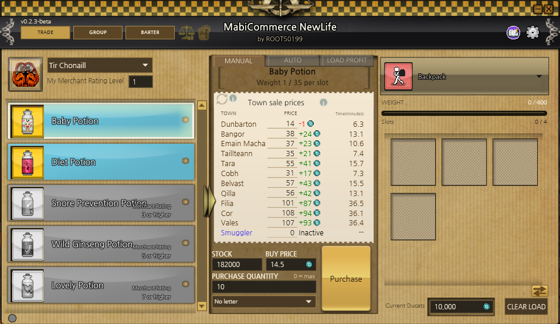
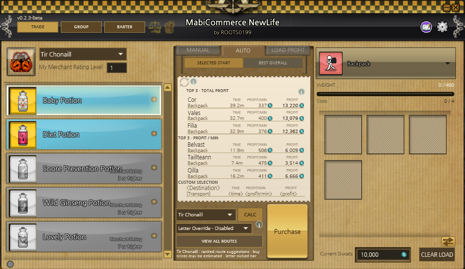
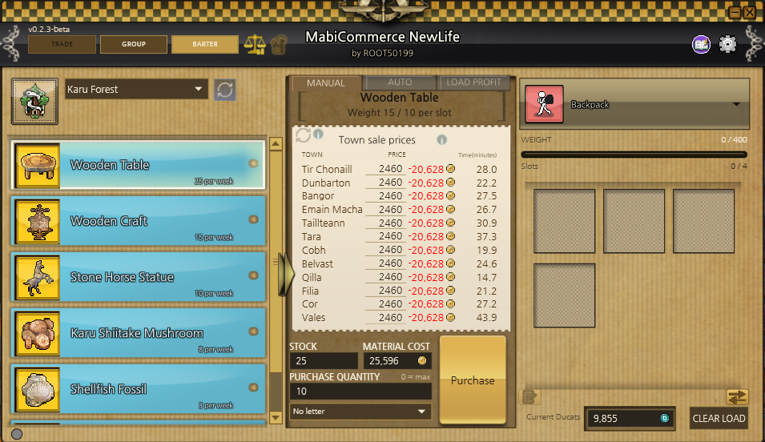
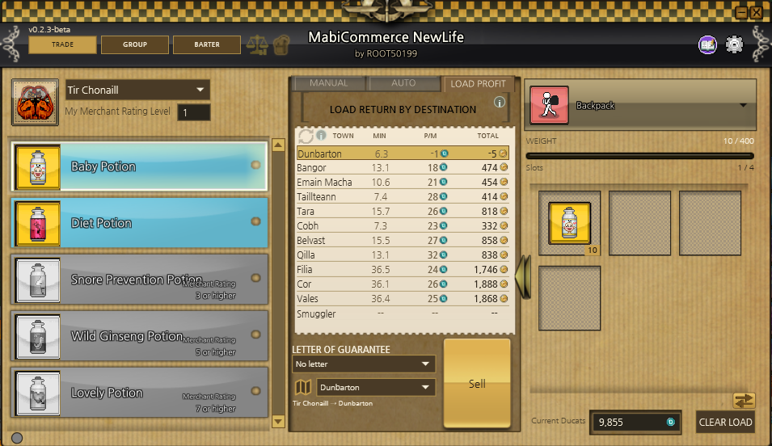

# MabiCommerce NewLife

A Windows desktop planner for Mabinogi commerce (C# / WPF, .NET 9). Enter or scan prices, plan loads, and compare profit, travel time and Gold per minute across trading posts.

The window recreates the in-game Trading Post using art, icons and fonts taken from the game client.

## Screenshots

**Manual**



**Auto**



**Barter**



**Load Profit**



## Features

- **Trade, Group and Barter** pages, each with its own goods list, transport load and stock.
- **Manual** tab: edit buy and sale prices; see per-item profit and travel time.
- **Auto** tab: ranks the best destinations or routes by total profit; Trade and Group also show profit-per-minute rankings. Barter shows the top five overall plus Custom Selection. Each page remembers a **Letter override**: **Letter Override - Disabled** keeps Auto's usual market-priced letter selection; **No letter** excludes all letters; a picked letter forces that letter at **0 G** in Auto estimates, even with none held. Changing the override requires recalculation. Manual and Load Profit still use Inventory market values, including after selecting or loading an Auto route.
- **Load Profit** tab: profit, time and Gold per minute for every destination for your current load.
- **Screen scan (OCR)**: press SCAN and select the good's name, **Inventory count**, and full price list with a small margin around both brackets. Prices keep their existing cross-checks; stock requires agreeing reads. Missing/uncertain stock or failed price checks open review. **APPLY STOCK** lets you confirm/edit a non-negative whole count, including **0**; leaving it unchecked preserves stock. The quantity slider's maximum is not stock.
- **Catalog sanity bounds**: source buys may range from a quarter of the discounted historic minimum to four times the historic maximum; Barter's median base uses quarter-minimum to four times maximum. These reject gross errors, not normal market variation. Exact automatic source/sale/profit arithmetic, independent OCR agreement and Barter's per-town model checks remain unchanged.
- **Obstructed scans**: if an identified good has missing destination names or unreadable entries, SCAN retries the same selected rectangle once a second for up to five seconds (five additional captures). Move the mouse or popup out of the table. A complete retry proceeds through the normal price/stock checks; otherwise an error sound and **Scan obstructed** alert appear, with nothing applied. Capturing stops after the fifth retry; slower OCR may take additional time to finish those captures. Repeated clicks cannot start overlapping scans. This is a bounded retry of your explicit scan, not background monitoring.
- **Inactive Smuggler**: an accepted scan with no Smuggler reading clears that good's old Smuggler quote to 0 and labels it **Inactive**. Sync applies the same inactivity when a complete shared observation omits Smuggler; newer local edits still win. Inactive quotes persist locally and cannot supply Auto/Load Profit/Sell prices. A later positive scan/shared/manual quote reactivates the destination. A detected but unreadable Smuggler row still requires obstruction recovery, not silent deactivation.
- **Scanned stock limits**: Trade scans replace remaining post stock. Group/Barter scans preserve your personal weekly remainder and add a separate observed post-supply cap; Purchase and Auto obey both. Loading consumes both limits; removing/clearing cargo refunds them, while Sell does not. Local OCR supply is session-only unless retained from shared data; turning sharing off or closing retains applied shared supply locally. Newer observations can replace supply; weekly reset does not refill it.
- **Route map overlay**: draws only your selected route on the game's minimap, step by step across regions.
- **Modifiers**: Commerce Mastery, Letters of Guarantee, merchant ratings, accessory enchants, speed buffs and other bonuses.
- **Commerce Expansion Cover**: editable Have and Market Gold beside letters in Inventory; default value **2,000,000 Gold**. Auto compares normal cargo with **+1 slot / +100 weight**, using one cover only when extra cargo improves net Gold after its market cost and letter bonuses, regardless of the displayed profit currency. Its cost is charged once per loaded trip, even if owned; blank/0 value disables consideration. Counts are manually tracked, like letters.
- **Transports**: choose which you own; partner and Alpaca variants are optional.
- **Weekly reset**: Group and Barter stock can refill automatically at the Thursday reset.
- **Barter materials**: track on-hand amounts and market Gold values; edit values in Barter Materials or the shopping list. Copy the list, including per-unit values, as a table to paste into Google Sheets.
- **Trade history** (in Settings): a log of every load sold with the Sell button, with running totals of raw Gold, Ducats and converted total Gold.
- **Scanned price sharing** (Settings > Calculator Behavior, under Screen reader mode): one initially-off, explicit-consent toggle enables sending automatically validated scans or complete scans confirmed in OCR review, and receiving shared prices/Inventory supply. Edited source/stock/destination values are flagged manual; unchanged confirmed values are reviewed OCR. Both can update other planners, with provenance in price/stock details. User and Dev builds use the same Cloudflare-hosted online service. Its ON/OFF choice, consented backend and sharing-policy version are saved in `config.json`; ON reconnects for that service/policy. A changed backend/policy or old unscoped consent becomes OFF until you enable sharing and accept. A random installation ID and authentication token are saved unencrypted in `community-credentials.json` beside the app and reused across launches; the backend stores only a token hash. Keep the file private: copying it shares the installation identity. OFF keeps it but stops transfers; saved credentials never enable sharing by themselves. Existing users must accept the updated storage disclosure once. Reconnect verifies saved authorization with a short-lived ticket without downloading prices or uploading observations. Rejected saved credentials remain disconnected, without automatically registering a replacement. Connection failures keep the saved ON choice. The small dark **refresh icon in the paper's upper-left corner** receives and applies newest data using your purchase discounts, at most once per minute across all tabs, including failed attempts and automatic retries. It stays visible while sharing is off; its adjacent info bubble explains connection state and cooldown. Turning scanner mode off saves sharing OFF; re-enabling scanning does not resume sharing. No character/account data, screenshots, raw OCR, personal weekly allowance or unrelated manual planner edits are sent. No polling, automatic price download on launch, or offline upload queue.
- **Sharing status:** the bottom-left dot is green when connected, yellow for connecting/temporary errors/rate limits, red for hard failures, and gray when OFF. Hover for a brief explanation; click yellow/red for a themed details panel with fixes, remaining wait and **Retry**. Retry stays disabled during active requests/server waits (and the refresh cooldown). Startup honors known server rate-limit delays, including waits longer than a minute; temporary startup privacy-read failures retry twice (5s/10s). Outside startup, connection/read/ticket retries require a known rate-limit delay strictly under one minute. Refresh retries still honor the global one-minute cooldown. Unknown/long non-startup limits require manual retry. OFF/close cancels waits. Ambiguous registration failures and scan uploads are never automatically replayed; after recovery, scan again to share a local-only scan.
- **Settings categories**: General contains Always on top, Reset Window Positions and all tooltip switches. Calculator Behavior contains Screen reader mode with subordinate save-region/debug/sharing options, automatic restock, time buffers, and Converted Gold/Ducats profit-display radio buttons. Only the two major category headings retain decorative brackets. Trade History remains at the bottom. Save-region/debug preferences are retained while scanner mode is off. Sharing consent leaves Settings open.
- **Tooltip settings**: toggle help bubbles, calculation breakdowns, and item/status tips independently. Help bubbles open on click or after a one-second hover; controls with bubbles do not repeat that help as a separate mouseover tooltip. Calculation/item-specific details remain available. Charts, barter materials, letters, and modifiers have dedicated help bubbles.
- **Notifications**: messages stack vertically in the bottom notification area. Routine status/progress messages last **10 seconds each**, or dismiss immediately when clicked anywhere on their card. Errors remain until individually dismissed with **X**; clicking error text does not clear them. Full messages wrap instead of truncating; a tall mixed stack scrolls. New messages never replace pending ones. Notifications are session-only, not a saved error log.
- **App updates**: Settings > General has **Check updates on app open** (saved, default **ON**) and **CHECK FOR UPDATES**. Checks include stable and beta GitHub releases; downloads/installations always ask permission.
- **User manual and tutorial**: the book beside Settings opens illustrated instructions for the main workflows, plus **Start tutorial tour**. Each topic includes a cropped app screenshot with example values. The 24-step tour highlights the relevant controls and dims the rest; use Next/Back, or the upper-right **X** / Escape to exit anytime. It opens Inventory, Barter Materials (including its Worth Running comparison), Settings, and a route-map example immediately after the map-button lesson. Three lessons immediately after slide 6 spotlight the sharing toggle, refresh icon, and bottom-left status dot without enabling sharing. Dedicated lessons show help bubbles, SCAN, and the shopping-list button, even when normally hidden; SCAN stays blocked during the tour. Settings highlights both its button and menu. Temporary previews restore on exit along with your original tab and auxiliary windows. A first-run invitation offers Start tutorial, Read manual, or Not now, once per app-folder profile (including existing profiles without the new prompt flag).

Settings, prices and transport choices are saved in `config.json` beside the exe; trade history is in `trade-history.json` beside it. Sharing credentials are in `community-credentials.json`, created only after consent and successful registration. Use a writable folder. Preserve these files when upgrading the same installation. Do not publish or share the credentials file, or copy it to a different person's installation. Deleting it loses the local identity and requires a new rate-limited registration. Rolling back to an older memory-only build ignores it without deleting it.
New profiles start with editable reference material and guarantee-letter values; existing saved values are kept.
Each app folder has its own profile; older AppData settings are not imported.

## What it does not do

It never connects to the game, reads its memory, captures packets or modifies the client. Screen capture only happens when you press SCAN, and only on the region you select, including at most five obstruction retries. Captured images are not saved.

This tool makes no claim about compatibility with Mabinogi's rules or anti-cheat. Follow the game's current terms.

## Limitations

- Prices are entered, scanned or explicitly synchronized community observations, not live game data.
- Community sharing still uses a local development backend, not a deployed service. The Settings toggle authorizes both sending and receiving; downloads happen only on REFRESH. An outage retains current planner values/cursor and leaves local scanning usable. Replaying a scan does not refill consumed supply; a genuinely newer observation may refresh the observed supply. Personal weekly allowance is never downloaded.
- Travel times are estimates from client map data and the ship schedule. Some regions have no route data.
- Barter rotations, exchange quantities and some bonus values still need in-game checking.
- Barter OCR allows prices from 25% below to 15% above its reference model, with agreeing reads and a median base inside the catalog range. Digit misreads within that band can still pass; review suspicious prices.
- Stock has no mathematical price cross-check: matching OCR reads are evidence, not a guarantee. Limited goods can be stock-gated. Scaled or unclear Inventory text may need review; the supplied scaled Lead capture suggests **400** but does not auto-apply.
- Obstruction detection checks expected destination entries, not the cursor or popup itself. An obstruction that leaves readable but wrong numbers still relies on the existing price/stock checks. An unidentified good cannot supply an expected row set. Smuggler is optional; when detected, its entry must be readable too.
- Trade profit OCR retries a failed cross-check with a larger single-row read; it still requires exact sale/profit/source agreement. Decorative frame marks are excluded from town-name text and row positioning.

Startup temporary-read retry delays default to 5s/10s; a supplied server wait overrides those defaults.

The saved sharing identity survives restarts and OFF/ON, but server revocation or expiry can still invalidate authorization. No hardware fingerprint is used. App folders have separate credential files; copying one to another folder makes those copies use the same installation identity.

## App updates

The upper-left edge of the black title bar shows the running version, with **by ROOT50199** beneath
the app title. Settings includes the full clickable repository URL:
https://github.com/Root50199/MabiCommerceNewLife (opens in your default browser).

The planner checks public releases from
[Root50199/MabiCommerceNewLife](https://github.com/Root50199/MabiCommerceNewLife/releases).
**Settings > General > Check updates on app open** is ON by default, including
existing profiles without this setting. Turn it OFF for manual checks only.
Checks run once per launch, not continuously, independently of scanned-price
sharing. GitHub receives the connection IP and updater user-agent, not planner,
character or account data. No GitHub login/token is required.

**CHECK FOR UPDATES** also works when launch checking is OFF. The info bubble
shows the current build version. Stable and beta releases are compared by version,
not publication order; drafts, equal versions and older versions are not installed.
The newest compatible package must have a GitHub SHA-256 digest.

When a newer Windows x64 ZIP exists, an app-themed dialog shows its version,
download size and **Download and install?** with **Yes / No**.
**No**, Escape or closing the dialog leaves the app unchanged; **Yes** authorizes download,
verification, installation and restart. Finish scanning/calculating first and
close other instances using the same app folder. Unsold cargo is not persisted.
While downloading/installing, editing is disabled to avoid starting new work.

The downloaded package is verified against GitHub's HTTPS metadata size/SHA-256,
then extracted with path/file-count/expanded-size limits. This is integrity
verification, not an independent publisher signature. Only the release EXE,
`Data`, `x64`, license and notice files are replaced; `config.json`,
`trade-history.json`, `community-credentials.json`, source code and unrelated local files are not overwritten.
Source-build output folders can update to the published app; this does not
pull or change their source checkout.

A temporary **Windows PowerShell** helper waits for this instance to exit,
checks for locked files without killing other instances, backs up affected
files, replaces them and launches the updated app. A writable extracted/output
folder is required; the updater does not elevate privileges and refuses source
roots/linked paths. Copy/install/restart-launch failures restore replaced files
where possible and show a recovery-folder error. This rollback does not certify
that a newly launched version is bug-free. Successful updates remove their
unique `%TEMP%\MabiCommerceUpdates\<id>` staging folder; failed helper operations
retain it for recovery. GitHub rate limits, offline/TLS failures or missing
package/digest metadata produce persistent, dismissible errors.

No new GitHub release is published by enabling these controls. A running build
already matching the newest release reports no update.

### Connection and firewall errors

Sharing and updates use outbound HTTPS (TCP 443); no inbound exception or port
forwarding is required. Standard Windows Firewall settings normally allow these
outbound requests. Restrictive outbound policies or third-party security software
can block them.

Persistent error cards distinguish network access denied, DNS failure, TLS
failure and timeouts when Windows/.NET supplies that evidence. A timeout alone
cannot identify a firewall block. HTTP server errors are not labeled firewall
failures. Cards retain the original error and provide retry/troubleshooting steps.

If blocked, open **Windows Security > Firewall & network protection > Advanced
settings > Outbound Rules** and check for a rule blocking
`MabiCommerceNewLife.exe`. Ask your administrator to permit this app's outbound
HTTPS; explicit block rules can override allow rules. Check third-party security
rules too. Do not disable your firewall or certificate validation.

Sharing connects to `mabicommerce-community.mabi-projects.workers.dev`.
Updates require `api.github.com`, `github.com`,
`release-assets.githubusercontent.com` and `objects.githubusercontent.com`.
For DNS errors check internet/DNS; for TLS errors check Windows date/time,
trusted certificates and HTTPS-inspecting antivirus/proxies. Managed networks
may require administrator help. The app does not inspect or modify firewall rules.

### Sharing consent

Enabling scanned price sharing opens an app-themed **Enable / Cancel** dialog
with the same light text color as Settings.
A short summary covers transfers, excluded personal/image data, 30-day IP/new
scan-link retention and retained price history. **Privacy and details** expands
the service address, legacy-link exemption, cleanup timing and full behavior.
Cancel is focused/default; Escape or closing declines. No connection starts
until Enable is chosen. Existing saved consent and OFF behavior are unchanged.

## Community scan test

Launch the user build from this checkout:

```powershell
npm run "launch user"
```

This builds Release into `bin\User` and opens the app, retaining that folder's
settings/history across launches. It refuses to rebuild while that user build is
running; close it first. It does not start the community backend. The existing
`npm run "launch dev"` command remains separate. These npm shortcuts require the
checkout's local `package.json`.

Nothing connects until you explicitly enable **Scanned price sharing**
in Settings and accept its consent dialog. Both User and Dev builds use
`https://mabicommerce-community.mabi-projects.workers.dev/`; no local backend
process or sibling checkout is needed to use sharing. Redirects/proxies
are disabled. The former diagnostic Community window is no longer used.

In the desktop checkout, build a separate app-folder profile:

```powershell
dotnet build .\MabiCommerceNewLife.csproj --no-restore -p:OutputPath=.\bin\SettingsOpenTest\
Start-Process .\bin\SettingsOpenTest\MabiCommerceNewLife.exe
```

1. Enable **Screen reader mode** in Settings if SCAN is hidden.
2. Turn on **Settings > Scanned price sharing** and accept the consent dialog.
   The adjacent info bubble explains sending/receiving, privacy and retention.
   Sharing starts off until consented, then remembers ON/OFF across launches. Credentials exist only in memory;
   disabling discards them, and re-enabling registers a new installation.
3. Press **SCAN** in the main window and select the real price table as usual.
   The local OCR and existing review/application behavior are unchanged.
4. An automatically accepted scan with reliable Inventory count is eligible for
   immediate sharing. Trade/Group additionally require an independently read
   source price and **exact** observed sale/profit/source arithmetic for every
   destination. Failing automatic checks opens review instead of uploading.
   After confirming all destinations, source price and Inventory stock, the
   reviewed result is shared too. Edited values carry manual provenance.
   Missing/inconsistent observed profits are null, never invented from edited
   prices. Barter has no source-price requirement.
5. Barter shares its real sale-only table and observed Inventory count; source
   cost and profit are null, never invented from recipe/planner values. Prices
   must still pass the app's existing Barter agreement/reference-model checks.
6. The main status reports successful uploads or errors. Press the **refresh icon**
   in the paper's upper-left corner to receive and apply shared prices/observed supply. The initial
   request downloads latest state; subsequent requests fetch only changes after
   the cursor. Refresh is disabled until sharing is enabled, during an active
   refresh, and for 60 seconds after any refresh attempt starts, including failed
   attempts. Its countdown is shared across goods/tabs; turning sharing off/on
   does not bypass it. Uploading a scan does not trigger a download.
7. Cancelled or partial/unconfirmed reviews never upload. Missing destinations
   still trigger the existing obstruction/retry behavior. A failed ticket/upload
   is not queued or retried offline. Tickets expire after 60 seconds; confirmed
   review renews its ticket within the same still-enabled sharing session so
   time spent reviewing does not invalidate the upload.
8. Turn the Settings toggle off to cancel pending transfers, stop sending and
   receiving, and save the newest applied prices/supply locally, preserving consumption.
   Closing the main app also stops sharing and discards credentials. Disabling
   does not erase already stored observations.

Set the correct **source-post merchant level and discount gear before scanning**.
The source price in the game already includes those discounts. Uploads reverse
them once, sending a base purchase price plus the observed source/discount once
per scan; destination rows contain only post ID, sale price and observed profit.
The backend validates profits against the observed source, not the base price.
Recipients apply their own gear and source-post merchant discount to the base;
their calculated profit is sale minus their purchase price. Updating gear/merchant
level reprices only community-owned buys, never your raw manual/scanned buys.
Integer reversal uses nearest-whole rounding and is approximate. Barter remains
sale-only, without purchase discounts. Legacy scans without discount metadata
can supply sale prices/stock but never a shared buy price.

Newest values win per field, including manual edits and your own scans. Local
edits/captures use UTC timestamps; community observations use server receipt
time, so keep both clocks accurate. Ties favor local values. Buy/stock input tips
and sale calculation breakdowns identify the winning source/time. While sharing is
active, remote overlays remain in memory. Turning sharing off (or closing the app)
promotes the newest applied values to saved local prices/supply, keeping the
original observation timestamps and your effective discounted buy price. There is
no rollback to outdated inputs. Retained supply remains separate from personal
weekly allowance. Stock persistence refunds unsold cargo because cargo itself is
not saved. A moderation reset during sharing still falls back to the applicable
local baseline; values already retained locally stay local. Older/replayed
observations cannot refill consumed supply.

### Online pilot

`npm run "launch user"` builds Release and uses
`https://mabicommerce-community.mabi-projects.workers.dev/`. No local backend
process is needed. Enable Screen reader mode, then Scanned price sharing and
accept the online-service consent. Existing local-sharing consent does not
authorize online transfers. The reviewed/manual-sharing policy also requires
fresh consent once in both builds. Older clients cannot read reviewed observations;
rebuild both instances. Previously rejected scans are not queued or backfilled:
rescan and verify. The Settings info bubble shows the current endpoint.

For two independent user profiles, build a second Release output:

```powershell
dotnet build .\MabiCommerceNewLife.csproj -c Release -p:OutputPath=.\bin\OnlineRecipient\
```

Open each output's executable. Enable sharing in both; perform a real validated
SCAN in one and explicitly refresh the other. Check the recipient's own purchase
discounts, sale prices and remaining supply. No synthetic observations should be
uploaded to the production history. Keep output folders separate and do not
rebuild one while its app is running. The online service records connection IPs
privately under the retention policy below; Cloudflare platform retention is
separate from application cleanup.

For a two-instance online test, build a second output folder such as
`.\bin\CommunitySyncRecipient\`. Both instances use the online service but keep separate
app-folder profiles. Set different gear/merchant levels and enable sharing in
both instances. Scan in the first, then click **REFRESH** in the second.
Verify recipient buy/profit against
its own discount; purchase some cargo and sync again to check stock does not
refill. Do not overwrite an output folder while its app is running.

Consent covers **30-day private IP logs** and **indefinite individual price/stock
history**. New observations' installation links expire after 30 days, with unused
expired installation credentials deleted. Existing pre-policy links are unchanged
by owner choice. Cleanup runs on API use and periodically; outages can delay it.
Local testing records
loopback as the address. Successful scheduled/API cleanup removes expired IP
records; outages can delay physical deletion. Registration is limited to five
per IP/hour, so repeated enable/disable cycles may hit that quota.

The online backend's public read-only endpoints can also be inspected directly.
For a separately started local Worker/API test, substitute its loopback URL;
ordinary desktop builds do not switch to that Worker.

```powershell
$backend = 'https://mabicommerce-community.mabi-projects.workers.dev'
Invoke-RestMethod "$backend/v1/latest" -Headers @{'X-Community-Format'='normalized-v2'} | ConvertTo-Json -Depth 8
Invoke-RestMethod "$backend/v1/stats"
# Individual price history; substitute a product/mode from the catalog:
Invoke-RestMethod "$backend/v1/history?mode=trade&productId=301" -Headers @{'X-Community-Format'='normalized-v2'} |
    ConvertTo-Json -Depth 8
```

Local D1 data stays in the backend checkout's ignored `.wrangler\state\`
directory. Close the test app normally and Ctrl+C the backend terminal when
finished. No Cloudflare deployment/login or domain setup is required.

Optional fixture-to-real-Worker regression (use an **isolated disposable**
backend, not the database used for your real scans):

```powershell
$env:MABI_COMMUNITY_TEST_ENDPOINT = 'http://127.0.0.1:8793'
dotnet test .\CalculatorTests\CalculatorTests.csproj --no-restore --filter 'TestCategory=LocalCommunity'
Remove-Item Env:\MABI_COMMUNITY_TEST_ENDPOINT
```

This regression uses the owner's existing local Highlander Ore fixture and sends
structured parsed values only. It is skipped when the endpoint/fixture is absent.
It is not a live game scan.

## Install

Download the zip from [Releases](https://github.com/Root50199/MabiCommerceNewLife/releases), extract it anywhere and run `MabiCommerceNewLife.exe`. Keep the `Data` and `x64` folders next to the exe. No .NET install is needed; screen scan (OCR) needs the [Microsoft Visual C++ Redistributable (x64)](https://aka.ms/vs/17/release/vc_redist.x64.exe).

## Build

Requires the .NET 9 SDK on Windows.

```powershell
dotnet build
dotnet publish -c Release   # single self-contained exe in bin\Release\net9.0-windows\win-x64\publish
```

## Tests

```powershell
dotnet test .\CalculatorTests\CalculatorTests.csproj
```

OCR tests use your own screenshots, which are not in the repo. See [CalculatorTests/Fixtures/README.md](CalculatorTests/Fixtures/README.md).

## Contributing and releases

Work on `dev`; merge into protected `main` through a pull request after **Build and test** passes. Dependency updates also target `dev`.

Versions are **MAJOR.FEATURE.PATCH**. All beta releases stay `0.x.x-beta`.
Features/overhauls increment FEATURE and reset PATCH; minor tweaks, fixes and
chores increment PATCH. After beta, major/breaking releases increment MAJOR and
reset the other numbers. Graduation to `1.0.0` is an explicit release decision.

`npm run release` infers the next version at release preparation from Conventional
Commits since the nearest reachable version tag: `feat:` means FEATURE;
`fix:`, `perf:`, `refactor:`, `docs:`, `style:`, `test:`, `build:`, `ci:`, `chore:`
and `revert:` mean PATCH. `!` or a `BREAKING CHANGE:` footer means FEATURE during
beta, MAJOR afterward. The largest change wins. Use scopes normally, e.g.
`feat(sharing): sync scans`. Unrecognized commit subjects fail explicitly rather
than guessing; use `-Version` for a deliberate override. Uncommitted changes
cannot be classified: commit them first or prepare a version explicitly.

An already prepared project version newer than the last release is reused, not
bumped again. Ordinary builds never
change version numbers. `tools\Publish-Release.ps1 -Version 1.0.0` explicitly
graduates out of beta. The release script shows the chosen version and asks
before committing/pushing, merging through a PR and tagging. It is not run
automatically by builds.

Alternatively, update the project version on `dev`, merge to `main`, then push
a matching tag. Actions builds, tests and publishes the Windows zip and SHA-256
checksum. For local packaging without publishing, run `.\tools\Package-Release.ps1`.
Version inference regression checks: `.\CalculatorTests\ReleaseVersionTests.ps1`.

## Data

`Data/` holds the goods catalog, client UI art, fonts, route maps and the OCR model (Tesseract `tessdata`, Apache-2.0). To rebuild the catalog from a local client dump (requires ImageMagick):

```powershell
.\tools\Import-CommerceCatalog.ps1 -ClientDataRoot <path>
```

## Special Thanks

- [MabiCommerce](https://github.com/Xcelled/mabicommerce) by Xcelled: the original Mabinogi commerce calculator and the inspiration for this project.
- [Mabioned](https://github.com/exectails/Mabioned) by exectails: its region and collision readers made it possible to map the trade routes.
- [Tesseract OCR](https://github.com/tesseract-ocr/tesseract) and the [TesseractOCR](https://github.com/Sicos1977/TesseractOCR) .NET wrapper: power the price scanner.
- [Mabinogi World Wiki](https://wiki.mabinogiworld.com/): commerce mechanics, transport speeds and reward formulas.
- Naver: the Nanum Gothic font.

## License

The source code is released under the [MIT License](LICENSE). Third-party components keep their own licenses; see [THIRD-PARTY-NOTICES.txt](THIRD-PARTY-NOTICES.txt).

Mabinogi and its game assets are © Nexon. Art, icons, maps and names taken from the game client are not covered by the MIT License. This project is not affiliated with or endorsed by Nexon.
